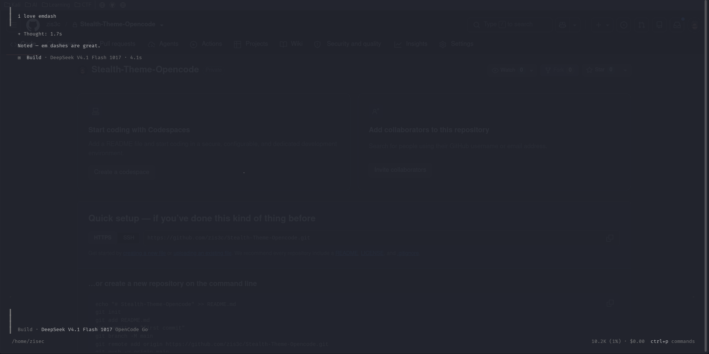

# Stealth Theme for OpenCode

[](https://github.com/zis3c/Stealth-Theme-Opencode/actions/workflows/ci.yml)
[](docs/OS-COMPATIBILITY.md)
[](docs/THEMING.md)
[](LICENSE)

Stealth Theme is a low-key, monochrome [OpenCode](https://opencode.ai) TUI theme that blends
into a plain terminal. It uses transparent surfaces, a gray-only palette and no bright
accents, so the interface does not stand out when you are working in a shared or recorded
session.

The theme is presentation-only. It does not change OpenCode's harness, models,
permissions, tools or behavior.

## Why this exists

Most themes are designed to be expressive. This one is designed to be quiet:

- Transparent app, panel, input and dialog backgrounds, so your terminal background shows through.
- Gray-only palette with readable primary text and subdued secondary text.
- Light and dark variants that follow the terminal color mode.
- No decorative color, no branding-heavy highlight.

## Features

- Drop-in theme file for OpenCode v1 (`tui.json`) and v2 (`cli.json`).
- Native installers for Linux, macOS and Windows (Bash + PowerShell + CMD).
- Preserves unrelated `tui.json` / `cli.json` settings such as keybinds.
- Optional palettes: `gray` (default), `amber` and `green`.
- Reversible: uninstallers restore the default OpenCode theme.
- CI on Ubuntu, macOS and Windows; theme structure and installer behavior are tested.

## Screenshot



The TUI sits flush on the terminal; the browser behind it is only visible because the
theme backgrounds are transparent.

## Supported platforms

| Platform | Installer | Status |
|---|---|---|
| Linux (amd64/arm64) | `install.sh` | Supported |
| macOS | `install.sh` | Supported |
| Windows (PowerShell) | `install.ps1` / `install.cmd` | Supported |
| Windows (Git Bash / WSL) | `install.sh` | Supported |

See [`docs/OS-COMPATIBILITY.md`](docs/OS-COMPATIBILITY.md) for details and limitations.

## Installation

### Linux / macOS

```bash
git clone https://github.com/zis3c/Stealth-Theme-Opencode.git
cd Stealth-Theme-Opencode
chmod +x install.sh
./install.sh
```

### Windows (PowerShell)

```powershell
git clone https://github.com/zis3c/Stealth-Theme-Opencode.git
cd Stealth-Theme-Opencode
powershell -ExecutionPolicy Bypass -File .\install.ps1
# or double-click install.cmd
```

### Windows (Git Bash / WSL)

```bash
./install.sh
```

Then restart OpenCode.

### Options

```bash
./install.sh --variant amber      # gray (default), amber, green
./install.sh --v2                 # write cli.json for OpenCode v2
```

```powershell
.\install.ps1 -Variant amber
.\install.ps1 -V2
```

The installer copies the theme to `<config>/themes/` and sets it as the active theme.
Custom config locations are supported with `OPENCODE_CONFIG_DIR`.

See [`docs/INSTALLATION.md`](docs/INSTALLATION.md) for manual installation and
[`docs/WINDOWS.md`](docs/WINDOWS.md) for the native Windows guide.

## Quick start

```bash
./install.sh
# restart opencode
# switch at any time: Ctrl+P -> Theme
```

To return to the default look:

```bash
./uninstall.sh
# or: Ctrl+P -> Theme -> opencode
```

## Repository scope

This repository contains the theme files, cross-platform installers, tests and
documentation. It does not vendor OpenCode and does not modify the OpenCode binary.

## Repository layout

```text
Stealth-Theme-Opencode/
├── themes/                       stealth.json, stealth-amber.json, stealth-green.json
├── install.sh / uninstall.sh     Linux, macOS, Git Bash, WSL
├── install.ps1 / uninstall.ps1   Windows PowerShell
├── install.cmd / uninstall.cmd   Windows double-click wrappers
├── tests/                        theme validation + installer tests
├── docs/                         installation, compatibility, theming, Windows, index
└── .github/workflows/            ci.yml, release.yml
```

## Documentation

Start at [`docs/INDEX.md`](docs/INDEX.md). See [`CONTRIBUTING.md`](CONTRIBUTING.md) for
development checks and [`LICENSE`](LICENSE) for licensing.

## License

MIT — see [LICENSE](LICENSE).
